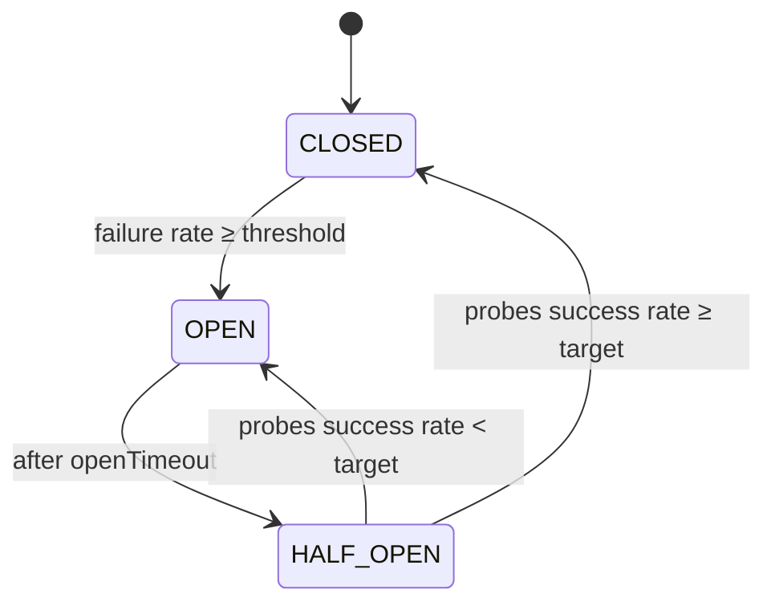

# 🚦 Go Circuit Breaker

[](https://pkg.go.dev/github.com/anilonayy/circuitbreaker)
[](LICENSE)

Production‑ready, lightweight Circuit Breaker for Go. Protects your external calls (HTTP, DB, RPC) by monitoring failures in a sliding time window, opening on sustained errors, and probing recovery in half‑open before safely closing.

• Simple API • Sensible defaults • Powerful options • Observability built‑in

---

## 🔧 Install

```
go get github.com/anilonayy/circuitbreaker@latest
```

Requires Go 1.25 or newer. The library itself has no dependencies outside the standard library (`testify` is used by the tests only).

## ⚡ TL;DR (Quick Start)

```go
package main

import (
    "context"
    "errors"
    "fmt"
    "time"

    circuitbreaker "github.com/anilonayy/circuitbreaker"
    "github.com/anilonayy/circuitbreaker/options"
)

func main() {
    // Start with a preset, then customize if needed
    opts := options.WithHTTPDefaults()
    opts = append(opts,
        options.WithFailureRateThreshold(0.5),      // open if 50%+ failures
        options.WithOpenTimeout(30*time.Second),    // stay open 30s
        options.WithRequestTimeout(5*time.Second),  // per-call timeout
    )
    cb := circuitbreaker.NewCircuitBreaker("payment-service", opts...)

    ctx := context.Background()
    err := cb.Execute(ctx, func(ctx context.Context) error {
        // Do your external call (respect ctx)
        // return an error to count as failure
        return nil
    })

    switch {
    case err == nil:
        fmt.Println("ok")
    case errors.Is(err, circuitbreaker.ErrCircuitBreakerOpen):
        fmt.Println("fast-fail: circuit open")
    case errors.Is(err, circuitbreaker.ErrCircuitBreakerTimeout):
        fmt.Println("breaker: request timeout")
    default:
        fmt.Printf("call error: %v\n", err)
    }
}
```

## 🚨 Todos

- [x] MVP
- [x] Add different framework examples (net/http, gin, echo): [`examples/`](examples)
- [x] Unit tests (`circuitbreaker_test.go`, `circuitbreaker_semantics_test.go`, `options/options_test.go`)
- [x] Add benchmarks (`circuitbreaker_bench_test.go`, [results](#-benchmarks))
- [x] Add documentation (package docs in `doc.go`, runnable examples in `example_test.go`)
- [x] Add regression tests (`TestRegression*` in `circuitbreaker_concurrency_test.go`)


---

## 🧭 How It Works



- Closed: traffic flows; failures are tracked in a sliding time window. Once the window holds at least the minimum number of requests and the failure rate reaches the threshold, the breaker opens.
- Open: fast‑fail; rejects immediately; waits `openTimeout` before probing. There is no background timer: the breaker turns Half‑Open when the first request arrives after `openTimeout`, so an idle breaker keeps reporting `OPEN`.
- Half‑Open: lets through at most `ThresholdRequestInHalfOpen` probe requests per round, counting the ones still in flight, and rejects the rest with `ErrCircuitBreakerOpen`. Once all probes have completed it closes if their success rate ≥ target, otherwise re‑opens. A probe that times out counts as a failed probe. Closing starts a fresh window, so the probes of that round do not count towards opening again.

The full semantics (timeouts, panics, listeners, the registry) are written up in the [package documentation](https://pkg.go.dev/github.com/anilonayy/circuitbreaker).

---

## ✨ Features

- Sliding window metrics with per‑second buckets
- Configurable thresholds and timeouts
- Half‑open probing with target success ratio
- Custom error predicate (choose what counts as a failure)
- Event hooks: state changes and request completion
- Global registry to manage breakers by key
- Detailed statistics for dashboards/logs

---

## ⚙️ Configuration

Import `github.com/anilonayy/circuitbreaker/options` and compose any of the options below. The default is what `NewCircuitBreaker` uses when the option is not passed.

| Option | Default | What it does |
| --- | --- | --- |
| `WithTimeWindow(d time.Duration)` | 1 minute | Length of the sliding window the failure rate is calculated over. Counted in whole seconds. |
| `WithMinimumRequestThreshold(n int64)` | 10 | Requests the window must hold before the failure rate can open the breaker. |
| `WithFailureRateThreshold(p float64)` | 0.5 | Failure rate (0–1) at or above which the Closed breaker opens. |
| `WithOpenTimeout(d time.Duration)` | 30 seconds | How long the breaker stays Open before it lets probes through. |
| `WithRequestTimeout(d time.Duration)` | 5 seconds | Deadline of the context passed to your function; a request that runs into it counts as a failure. |
| `WithThresholdRequestInHalfOpen(n int64)` | 10 | Probe requests admitted, and evaluated, per Half‑Open round. |
| `WithTargetRateInHalfOpen(p float64)` | 0.6 | Share of successful probes (0–1) required to close again. |
| `WithCustomErrorPredicate(func(error) bool)` | every non‑nil error is a failure | Decides which returned errors count as failures. Not asked about timeouts. |
| `WithStateChangeListener(any)` | none | Callback for every state transition. Must be a `func(from, to circuitbreaker.State)`; any other type panics. |
| `WithRequestCompleteListener(func(success bool, d time.Duration))` | none | Callback for every admitted request with its outcome and duration. |

Options are applied in order, so a later one overrides an earlier one. An option with an out‑of‑range value (a duration or count that is not positive, a rate outside 0–1, a `nil` predicate) is silently skipped and the previous value stays; no error is reported. `WithStateChangeListener` skips `nil` the same way, but a value of the wrong type is a programming error and makes `NewCircuitBreaker` panic instead of leaving you with a listener that never fires. The `Set*` methods on a breaker follow the same rule: an out‑of‑range value leaves the setting as it was.

Mind the two ends of the rate options: `WithFailureRateThreshold(0)` opens the breaker as soon as the minimum number of requests is reached, failures or not, and `WithTargetRateInHalfOpen(0)` closes it after the probes whatever their outcome.

### Presets

Each preset returns a `[]options.Option` you can append overrides to. A dash means the preset leaves that setting at its default.

| Preset | Window | Min. requests | Failure rate | Open timeout | Request timeout | Probes | Target rate |
| --- | --- | --- | --- | --- | --- | --- | --- |
| `WithDefaults()` | 1m | 10 | 0.5 | 30s | 5s | 10 | 0.6 |
| `WithTestDefaults()` | 1m | 5 | 0.5 | 30s | 3s | 10 | 0.6 |
| `WithAggressive()` | 30s | 5 | 0.3 | 2m | 3s | 5 | 0.8 |
| `WithConservative()` | 2m | 20 | 0.7 | 15s | 10s | 15 | 0.5 |
| `WithHTTPDefaults()` | 1m | 10 | 0.5 | 30s | 30s | – | – |
| `WithDatabaseDefaults()` | 2m | 15 | 0.6 | 45s | 15s | – | – |
| `WithMicroserviceDefaults()` | 1m | 8 | 0.4 | 20s | 8s | – | – |

`WithDefaults()` spells out the values a breaker uses when it is given no options.

### Builder

```go
opts := options.NewConfigBuilder().
    TimeWindow(60).                     // seconds
    MinimumRequestThreshold(20).
    FailureRateThreshold(0.4).
    OpenTimeout(45).
    RequestTimeout(10).
    ThresholdRequestInHalfOpen(8).
    TargetRateInHalfOpen(0.7).
    Build()

cb := circuitbreaker.NewCircuitBreaker("svc", opts...)
```

### Changing a live breaker

Every option has a matching setter on the breaker (`SetOpenTimeout`, `SetFailureRateThreshold`, …) that can be called while requests are in flight. The setters store what they are given: the range checks described above are done by the `With…` functions only.

---

## 🧪 Practical Examples

### HTTP call with custom failure predicate

```go
var errNotFound = errors.New("not found")

opts := append(options.WithHTTPDefaults(),
    options.WithCustomErrorPredicate(func(err error) bool {
        // A 404 says nothing about the health of the upstream:
        // return it to the caller, but do not count it as a failure
        return !errors.Is(err, errNotFound)
    }),
)
cb := circuitbreaker.NewCircuitBreaker("http-upstream", opts...)

err := cb.Execute(context.Background(), func(ctx context.Context) error {
    // net/http client call that respects ctx
    return nil
})
```

### Event hooks for observability

```go
cb := circuitbreaker.NewCircuitBreaker(
    "orders",
    options.WithStateChangeListener(func(from, to circuitbreaker.State) {
        fmt.Printf("state: %s -> %s\n", from, to)
    }),
    options.WithRequestCompleteListener(func(success bool, d time.Duration) {
        fmt.Printf("done: success=%v duration=%s\n", success, d)
    }),
)
```

### Reading metrics

```go
total, ok, fail, rate := cb.GetStatistics()
fmt.Printf("total=%d ok=%d fail=%d rate=%.2f\n", total, ok, fail, rate)

details := cb.GetDetailedStatistics()
fmt.Println(details.State, details.Key)
// includes Open/Half‑Open timestamps, counters, and thresholds;
// marshals to JSON for a status endpoint
```

Durations come twice: the `...Seconds` fields are whole seconds, rounded down, and the `...Millis` fields (`open_timeout_ms`, `request_timeout_ms`, `time_until_half_open_ms` in JSON) carry the exact value, so a timeout below one second does not read as 0.

### Registry utilities

```go
_ = circuitbreaker.NewCircuitBreaker("billing")
if got, ok := circuitbreaker.GetCircuitBreaker("billing"); ok { _ = got }
for _, k := range circuitbreaker.ListCircuitBreakers() { _ = k }
circuitbreaker.RemoveCircuitBreaker("billing")
```

More examples, each verified by `go test`, are in [`example_test.go`](example_test.go) and show up on pkg.go.dev.

---

## 🌐 Framework Examples

[`examples/`](examples) has a runnable middleware for each of:

| Framework | Example | Run |
| --- | --- | --- |
| `net/http` | [`examples/nethttp`](examples/nethttp/main.go) | `go run ./nethttp` |
| Gin | [`examples/gin`](examples/gin/main.go) | `go run ./gin` |
| Echo (v5) | [`examples/echo`](examples/echo/main.go) | `go run ./echo` |

Each one puts the breaker in front of a downstream HTTP call, passes the breaker's context on to that call so it is canceled at the request timeout, and maps the result to a response:

| Result of `Execute` | Response |
| --- | --- |
| `nil` | whatever the handler wrote |
| `ErrCircuitBreakerOpen` | `503 Service Unavailable`, the downstream is not called |
| `ErrCircuitBreakerTimeout` | `504 Gateway Timeout` |
| any other error | `502 Bad Gateway` |

The examples start a pretend downstream themselves, so they run as they are:

```
cd examples
go run ./nethttp                              # or ./gin, ./echo
curl -i 'localhost:8080/quote'                # 200
curl -i 'localhost:8080/quote?mode=error'     # 502, repeat a few times …
curl -i 'localhost:8080/quote?mode=slow'      # 504
curl -i 'localhost:8080/quote'                # … and now 503 until the open timeout has passed
```

`examples/` is a separate Go module, so Gin and Echo are not dependencies of the library.

---

## 🚨 Errors

| Error | Meaning | Was your function called? | Counted as failure? |
| --- | --- | --- | --- |
| `ErrCircuitBreakerOpen` | Request rejected (fast‑fail): the circuit is Open, or it is Half‑Open and all probe slots are taken | No | No, rejected requests are not counted |
| `ErrCircuitBreakerTimeout` | The request ran into a deadline: your function returned an error wrapping `context.DeadlineExceeded`, or `ExecuteWithTimeout` stopped waiting for it | Yes | Yes, always |
| any other error | Returned by your function and passed through unchanged | Yes | If the error predicate says so (default: yes) |

Compare with `errors.Is`. Two details worth knowing:

- A timeout is recognized by the error, not by the breaker's clock. A deadline your function set itself, or one on the caller's context, is reported as `ErrCircuitBreakerTimeout` too.
- A caller that cancels its context is not a timeout: both `Execute` and `ExecuteWithTimeout` return `context.Canceled`, and the error predicate decides whether it counts (the default predicate says yes).

---

## 🔒 Concurrency Guarantees

- All methods of a breaker and all registry functions are safe for concurrent use. The suite passes under `go test -race`.
- A single internal lock per breaker protects state, configuration and metrics. Admitting a request and recording its result are each atomic, so concurrent callers see one consistent state machine: callers racing through an expired open timeout cause a single `OPEN → HALF_OPEN` transition and share one set of probe slots.
- At most `ThresholdRequestInHalfOpen` probes are in flight in Half‑Open, however many callers arrive at once.
- A request that was admitted while the breaker was Closed and finishes during a later Half‑Open round is not counted as a probe.
- Your function, the error predicate and the event hooks run outside the lock. Hooks run asynchronously, each call in its own goroutine: they may call back into the breaker, and calls for successive events are not ordered.
- The setters may be called while requests are in flight; a request keeps the request timeout and error predicate it was admitted with.
- `GetDetailedStatistics` returns a snapshot that later requests do not change.

---

## Notes

- Context‑aware: your function receives a context that is canceled at the request timeout. `Execute` waits for the function to return, so the function has to honor that context; one that ignores it and returns `nil` late is a success.
- `ExecuteWithTimeout` does not rely on that: it runs the function in its own goroutine and returns as soon as the context is done: `ErrCircuitBreakerTimeout` at a deadline, `context.Canceled` if the caller canceled. The function keeps running in the background and its result is discarded, so use it for calls that cannot be canceled.
- Panics: if the wrapped function (or the error predicate) panics, the request is recorded as a failure, exactly like a returned error (statistics, Half‑Open probe result, request‑complete hook with `success=false`), and the panic reaches the caller with its original value. The breaker never swallows a panic.
- `NewCircuitBreaker(key, ...)` registers the breaker under `key`; calling it again with an existing key returns the already-registered breaker and ignores the new options. Breakers are never removed from the registry on their own, so use keys that name a dependency, not a request.
- Stringer: `cb.String()` prints a compact summary for logs.

---

## 📈 Benchmarks

Overhead of the breaker around a function that does nothing. Measured on this machine: AMD Ryzen 7 7800X3D (8 cores, 16 threads), Linux amd64, Go 1.27.2. Each value is the median of 5 runs, rounded to three significant digits.

```
go test -run '^$' -bench . -benchmem -count=5
```

| Benchmark | What it measures | ns/op | B/op | allocs/op |
| --- | --- | ---: | ---: | ---: |
| `ExecuteClosed` | `Execute`, Closed, call succeeds | 487 | 272 | 4 |
| `ExecuteClosedParallel` | same, from 16 goroutines | 579 | 272 | 4 |
| `ExecuteClosedFailure` | `Execute`, Closed, call fails | 490 | 272 | 4 |
| `ExecuteOpen` | `Execute`, Open (rejected) | 25.4 | 0 | 0 |
| `ExecuteOpenParallel` | same, from 16 goroutines | 54.5 | 0 | 0 |
| `ExecuteHalfOpenProbe` | `Execute`, Half‑Open, admitted probe | 421 | 272 | 4 |
| `ExecuteHalfOpenProbeParallel` | same, from 16 goroutines | 460 | 272 | 4 |
| `ExecuteHalfOpenRejected` | `Execute`, Half‑Open, probe slots taken (rejected) | 10.9 | 0 | 0 |
| `ExecuteWithTimeoutClosed` | `ExecuteWithTimeout`, Closed | 1380 | 912 | 11 |
| `ExecuteWithTimeoutClosedParallel` | same, from 16 goroutines | 813 | 912 | 11 |
| `ExecuteWithTimeoutOpen` | `ExecuteWithTimeout`, Open (rejected) | 25.4 | 0 | 0 |
| `ExecuteClosedListeners/none` | `Execute`, Closed, no hooks | 485 | 272 | 4 |
| `ExecuteClosedListeners/state-change` | same, with a state‑change hook | 489 | 272 | 4 |
| `ExecuteClosedListeners/request-complete` | same, with a request‑complete hook | 636 | 304 | 5 |
| `ExecuteClosedListeners/both` | same, with both hooks | 631 | 304 | 5 |
| `GetState` | `GetState` | 3.76 | 0 | 0 |
| `GetDetailedStatistics` | `GetDetailedStatistics` | 79.7 | 0 | 0 |

- A healthy call through a Closed breaker costs about half a microsecond and 4 allocations.
- A rejected call costs between about 10 and 55 nanoseconds and allocates nothing, which is the point of failing fast.
- A breaker is guarded by one lock, so `Execute` through the same breaker does not get faster with more cores: under contention from 16 goroutines a call takes somewhat longer than a sequential one (the "from 16 goroutines" rows).
- `ExecuteWithTimeout` pays for the extra goroutine, and a request‑complete hook for the goroutine it is delivered in.

Numbers depend on hardware and Go version; run the command above to get yours.

---

## 🧷 Tests

```
go test -race ./...
```

Tests that wait for the open timeout or the request timeout run on a virtual clock (`testing/synctest`), so they take no real time and do not depend on scheduling. Every concurrency and panic-handling bug fixed so far is pinned by a regression test named after it (`go test -race -run Regression -v .`); each of them fails against the code from before the fixes.

---

## License

MIT — see `LICENSE`.
