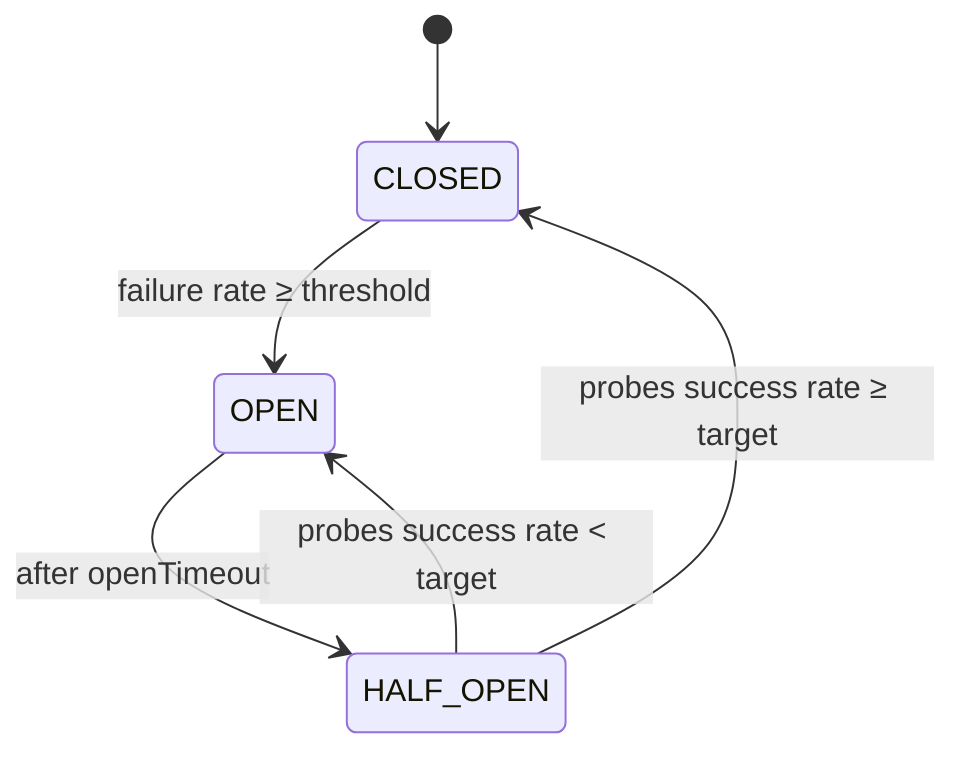

# 🚦 Go Circuit Breaker

[](https://pkg.go.dev/github.com/anilonayy/circuitbreaker)
[](LICENSE)

Production‑ready, lightweight Circuit Breaker for Go. Protects your external calls (HTTP, DB, RPC) by monitoring failures in a sliding time window, opening on sustained errors, and probing recovery in half‑open before safely closing.

• Simple API • Sensible defaults • Powerful options • Observability built‑in

---

## 🔧 Install

```
go get github.com/anilonayy/circuitbreaker@latest
```

## ⚡ TL;DR (Quick Start)

```go
package main

import (
    "context"
    "fmt"
    "time"

    circuitbreaker "github.com/anilonayy/circuitbreaker"
    "github.com/anilonayy/circuitbreaker/options"
)

func main() {
    cb := circuitbreaker.NewCircuitBreaker(
        "payment-service",
        // Start with a preset, then customize if needed
        options.WithHTTPDefaults()...,              // sensible HTTP defaults
        options.WithFailureRateThreshold(0.5),      // open if 50%+ failures
        options.WithOpenTimeout(30*time.Second),    // stay open 30s
        options.WithRequestTimeout(5*time.Second),  // per-call timeout
    )

    ctx := context.Background()
    err := cb.Execute(ctx, func(ctx context.Context) error {
        // Do your external call (respect ctx)
        // return an error to count as failure
        return nil
    })

    switch err {
    case nil:
        fmt.Println("ok")
    case circuitbreaker.ErrCircuitBreakerOpen:
        fmt.Println("fast-fail: circuit open")
    case circuitbreaker.ErrCircuitBreakerTimeout:
        fmt.Println("breaker: request timeout")
    default:
        fmt.Printf("call error: %v\n", err)
    }
}
```

## 🚨 Todos

- [x] MVP
- [ ] Add different framework examples (echo, gin etc..)
- [ ] Add test coverage
- [ ] Add benchmarks
- [ ] Add documentation
- [ ] Add regression tests


Use `ExecuteWithTimeout` to let the breaker coordinate goroutine completion around its timeout.

---

## 🧭 How It Works



- Closed: traffic flows; failures are tracked in a sliding time window.
- Open: fast‑fail; rejects immediately; waits `openTimeout` before probing.
- Half‑Open: allows limited test requests; closes if success rate ≥ target, otherwise re‑opens.

---

## ✨ Features

- Sliding window metrics with per‑second buckets
- Configurable thresholds and timeouts
- Half‑open probing with target success ratio
- Custom error predicate (choose what counts as a failure)
- Event hooks: state changes and request completion
- Global registry to manage breakers by key
- Detailed statistics for dashboards/logs

---

## 🧩 Defaults

| Setting | Default |
| --- | --- |
| Time window | 1 minute |
| Minimum requests to evaluate | 10 |
| Failure rate threshold | 0.5 (50%) |
| Open timeout | 30 seconds |
| Per‑request timeout | 5 seconds |
| Half‑Open probe count | 10 |
| Half‑Open target success | 0.6 (60%) |

---

## ⚙️ Configuration

Import `github.com/anilonayy/circuitbreaker/options` and compose any of:

- `WithTimeWindow(d time.Duration)`
- `WithMinimumRequestThreshold(n int64)`
- `WithFailureRateThreshold(p float64)` (0–1)
- `WithOpenTimeout(d time.Duration)`
- `WithRequestTimeout(d time.Duration)`
- `WithThresholdRequestInHalfOpen(n int64)`
- `WithTargetRateInHalfOpen(p float64)` (0–1)
- `WithCustomErrorPredicate(func(error) bool)`
- `WithStateChangeListener(any)` → `func(from, to State)`
- `WithRequestCompleteListener(func(success bool, d time.Duration))`

Presets and helpers:

- `WithDefaults()`
- `WithHTTPDefaults()` / `WithDatabaseDefaults()` / `WithMicroserviceDefaults()`
- `WithAggressive()` and `WithConservative()`
- Builder pattern:

```go
opts := options.NewConfigBuilder().
    TimeWindow(60).                     // seconds
    MinimumRequestThreshold(20).
    FailureRateThreshold(0.4).
    OpenTimeout(45).
    RequestTimeout(10).
    ThresholdRequestInHalfOpen(8).
    TargetRateInHalfOpen(0.7).
    Build()

cb := circuitbreaker.NewCircuitBreaker("svc", opts...)
```

---

## 🧪 Practical Examples

### HTTP call with custom failure predicate

```go
cb := circuitbreaker.NewCircuitBreaker(
    "http-upstream",
    options.WithHTTPDefaults()...,
    options.WithCustomErrorPredicate(func(err error) bool {
        // Only treat real transport/timeouts as failures; app 4xx may not be
        return err != nil
    }),
)

err := cb.Execute(context.Background(), func(ctx context.Context) error {
    // net/http client call that respects ctx
    return nil
})
```

### Event hooks for observability

```go
cb := circuitbreaker.NewCircuitBreaker(
    "orders",
    options.WithStateChangeListener(func(from, to circuitbreaker.State) {
        fmt.Printf("state: %s -> %s\n", from, to)
    }),
    options.WithRequestCompleteListener(func(success bool, d time.Duration) {
        fmt.Printf("done: success=%v duration=%s\n", success, d)
    }),
)
```

### Reading metrics

```go
total, ok, fail, rate := cb.GetStatistics()
fmt.Printf("total=%d ok=%d fail=%d rate=%.2f\n", total, ok, fail, rate)

details := cb.GetDetailedStatistics()
fmt.Println(details.State, details.Key)
// includes Open/Half‑Open timestamps, counters, and thresholds
```

### Registry utilities

```go
_ = circuitbreaker.NewCircuitBreaker("billing")
if got, ok := circuitbreaker.GetCircuitBreaker("billing"); ok { _ = got }
for _, k := range circuitbreaker.ListCircuitBreakers() { _ = k }
circuitbreaker.RemoveCircuitBreaker("billing")
```

---

## 🚨 Errors

- `ErrCircuitBreakerOpen`: request rejected while circuit is Open (fast‑fail)
- `ErrCircuitBreakerTimeout`: request exceeded breaker’s per‑request timeout

---

## Notes

- Thread‑safe: internal locking protects state and metrics.
- Context‑aware: honors provided `context.Context` and enforces its own timeout.
- Stringer: `cb.String()` prints a compact summary for logs.

---

## License

Apache‑2.0 — see `LICENSE`.

